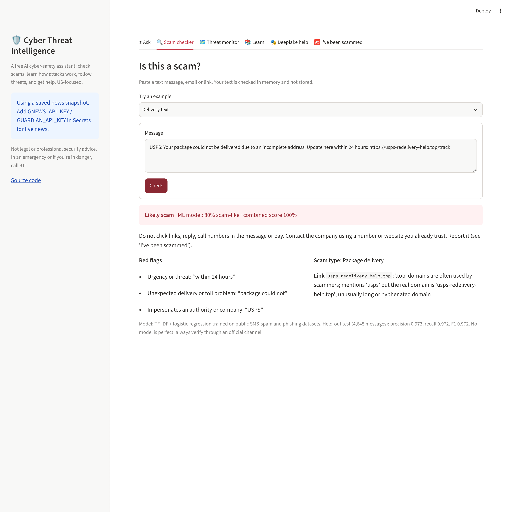
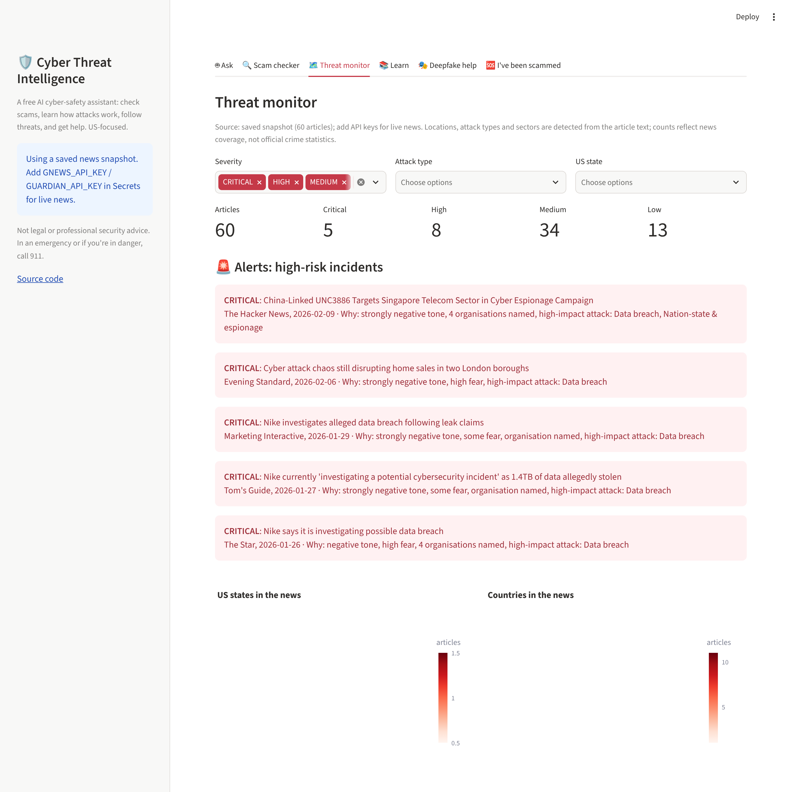
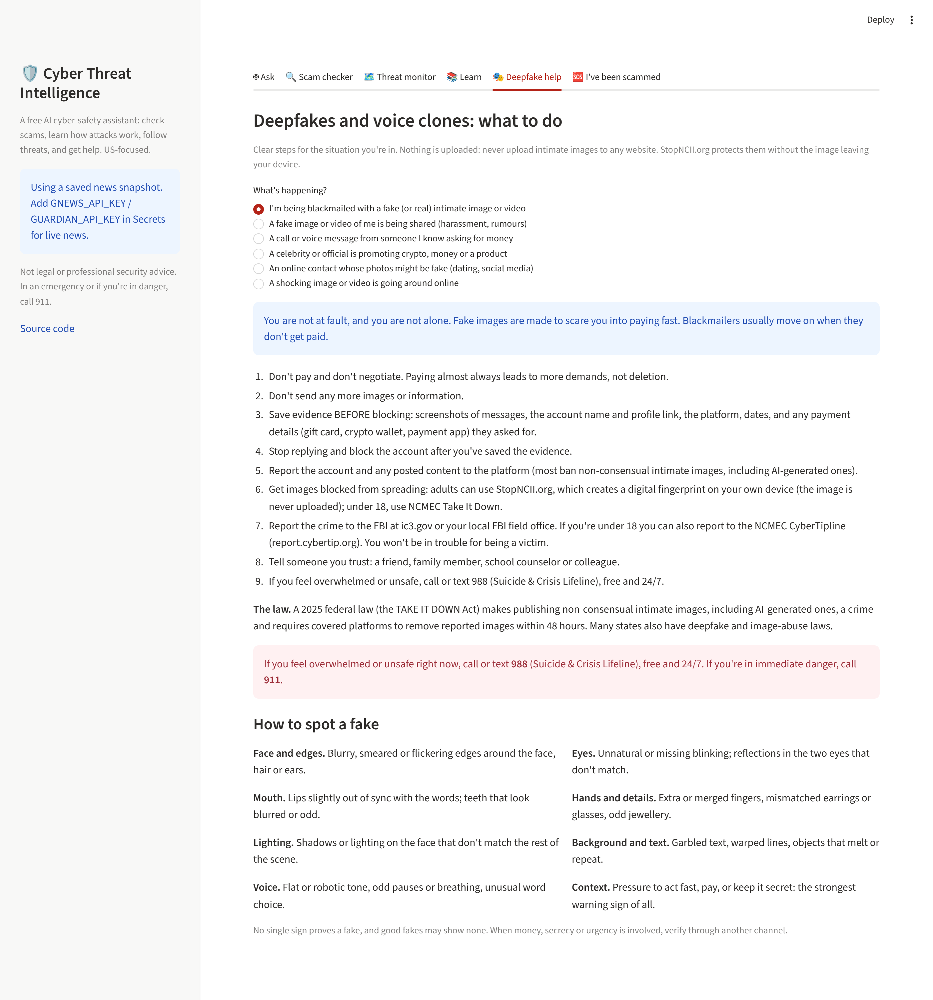

# Cyber Threat Intelligence: a free AI cyber-safety assistant


Companies pay security professionals to protect them. Most people can't, yet they face the same scams: fake bank and delivery texts, impersonation calls, tech-support scams, deepfakes and voice clones, sextortion and identity theft. This project is a **free, open-source assistant for the public** (US focus) that **checks suspicious messages, explains how attacks work, monitors cyber-threat news by attack type, sector and location, and tells people what to do and where to report**.

**▶ Live demo:** _link added after deployment_



## What it does

| | |
|---|---|
| 🤖 **Ask** | A cyber-safety assistant. Answers from a curated knowledge base (FTC / FBI IC3 / CISA guidance), queries the threat data by **attack pattern, sector or US state**, checks pasted messages, and refuses to help with attacks. A **local LLM** (Qwen2.5-Instruct) phrases answers and is rejected if it adds anything not in the sources |
| 🔍 **Scam checker** | Paste a text, email or link → verdict, **ML probability**, red flags with the exact words, scam type (bank, delivery, toll, IRS/SSA, tech support, prize, job, crypto, romance, family emergency) and link analysis (look-alike domains, shorteners, risky TLDs) |
| 🗺️ **Threat monitor** | NLP over live cyber news (GNews + The Guardian): attack types, **US states and cities**, countries, sectors, sentiment, emotion, organisations (NER) and **severity with reasons**; maps, alerts for high-risk incidents, filters |
| 📚 **Learn** | How phishing, impersonation, tech-support, romance/crypto, ransomware, identity theft, deepfakes and sextortion work, warning signs and protection (defensive only) |
| 🎭 **Deepfake help** | Step-by-step guidance by situation: **blackmail with a fake (or real) intimate image**, a fake of you being shared, voice-clone calls, fake celebrity endorsements, fake dating photos, viral fakes; plus how to spot a fake. **No uploads**: never upload intimate images to any website |
| 🆘 **I've been scammed** | Step-by-step playbooks (clicked a link, paid a scammer, identity theft, fake images, family-emergency call, ransomware) and where to report: FTC, IdentityTheft.gov, FBI IC3, StopNCII, NCMEC Take It Down |

<p>


</p>

## Scam classifier

TF-IDF (word 1–2-grams + character 3–5-grams) → logistic regression, trained on the public **UCI SMS Spam Collection** and an Apache-2.0 **phishing dataset** (emails and SMS). Duplicates removed before an 80/20 stratified split.

| Held-out test (4,645 messages) | Precision | Recall | F1 |
|---|---|---|---|
| **All** | 0.973 | 0.972 | **0.972** |
| Emails / mixed | 0.979 | 0.975 | 0.977 |
| SMS only | 0.913 | 0.938 | 0.926 |

The model is combined with **explainable rules** for tactics the FTC and FBI warn about. For example, *gift-card payment + secrecy* is escalated to "Likely scam" even when the model hasn't seen that wording: grandparent / voice-clone scams are rare in the training data. Retrain with `python -m cti.scam.train` (downloads the data).

## Threat-news pipeline

```
GNews + Guardian ──► title + description (Guardian has no description: the title isn't duplicated)
   │
   ├─ attack type, sector ......... whole-word keyword taxonomy (12 attack types, 10 sectors incl. energy)
   ├─ location .................... US states, major US cities → state, countries; whole-word matching
   │                                ("UK" ≠ "Ukraine", "Indiana" ≠ "India", "New Mexico" ≠ "Mexico")
   ├─ sentiment ................... VADER + DistilBERT (SST-2)
   ├─ emotion ..................... DistilRoBERTa emotion model (fear, anger, ...)
   ├─ organisations ............... BERT NER on the original-case text
   ▼
severity LOW / MEDIUM / HIGH / CRITICAL from tone, fear, anger, organisations, high-impact attack
types and critical sectors, with the reasons listed
```

The repo includes a 60-article snapshot so the app works without API keys. With keys, the app fetches US-edition news and re-analyses it every 30 minutes.

`notebooks/cyber_news_nlp_analysis.ipynb` is the original research notebook (topic modelling with LDA, VADER vs transformer sentiment, emotion analysis, FLAN-T5 experiments). The `cti/` package is the cleaned, tested version of that work.

## Run it

```bash
python -m venv .venv && source .venv/bin/activate
pip install -r requirements.txt
streamlit run app/streamlit_app.py
```

Live news (optional): get free keys from [gnews.io](https://gnews.io) and [The Guardian](https://open-platform.theguardian.com), then set `GNEWS_API_KEY` / `GUARDIAN_API_KEY` as environment variables or in `.streamlit/secrets.toml`. **Never commit keys.**

**Deploy free:** [share.streamlit.io](https://share.streamlit.io) → repository `malihashaik68/cyber-threat-intelligence`, branch `main`, main file `app/streamlit_app.py`. Add the two keys under Secrets. If memory is tight, add `CTI_USE_LLM = "0"`.

## Tests

```bash
pytest -q
```

23 tests in about 2 seconds, without model downloads: location and attack-type detection (including the "UK"/"Ukraine" and "New Mexico" cases), severity, scam verdicts and explanations, link analysis, assistant routing and refusals, the LLM grounding check, the deepfake-blackmail guidance and the knowledge base. GitHub Actions runs them on every push.

## Honest limits

- **Not professional security or legal advice.** Always verify through an official channel.
- The threat map counts **news coverage**, not official crime statistics; no free real-time source gives cybercrime by city.
- **No image analysis by design.** Deepfake detection is unreliable, and people shouldn't upload sensitive images to websites; the app gives situation-specific guidance instead (StopNCII.org protects images without uploading them).
- The scam model is trained on public datasets (some older, some marketing spam), so new scam wording can slip through: that's why the rule layer and advice exist.
- The local LLM is small; it only rephrases retrieved guidance and is rejected when it adds content.
- Defensive use only: the assistant refuses requests to attack, phish or impersonate anyone.

## Project structure

```
app/streamlit_app.py          the app (6 tabs)
cti/assistant.py              routing, retrieval, local LLM + grounding check, refusals
cti/scam/                     classifier training + checker (red flags, scam types, links)
cti/news/                     news collection, NLP analysis, locations, attack/sector taxonomy
cti/knowledge/content.py      lessons, recovery playbooks, official US resources
models/                       trained scam model + metrics
data/news_snapshot.csv        analysed 60-article snapshot
notebooks/                    original research notebook
tests/                        pytest suite
```

## Tech stack

Python · scikit-learn · Hugging Face Transformers (DistilBERT, DistilRoBERTa, BERT NER, Qwen2.5) · Sentence-Transformers · VADER · pandas · Plotly · Streamlit · GNews & Guardian APIs · pytest · GitHub Actions
